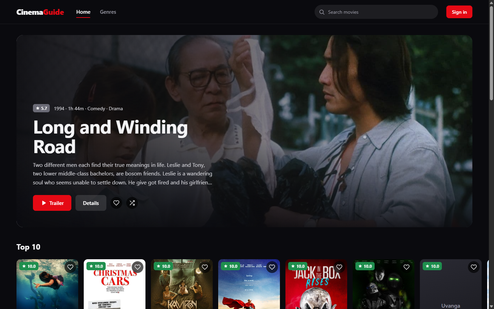
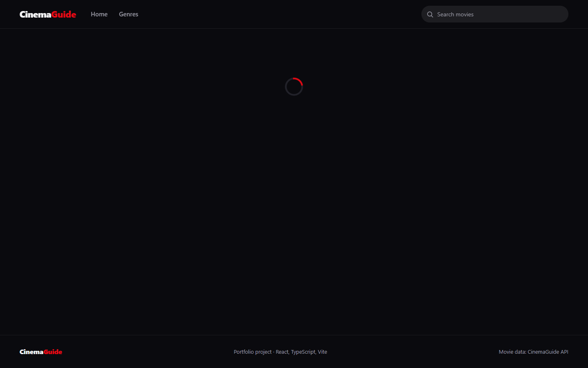
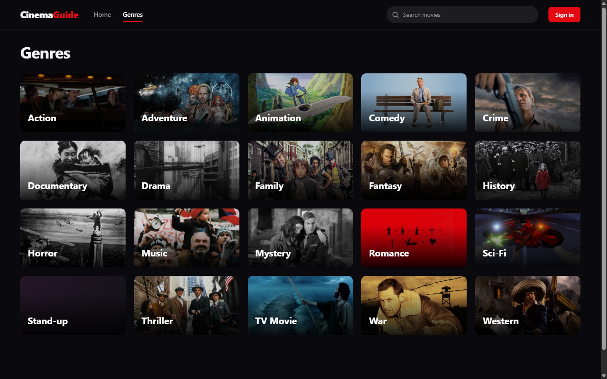
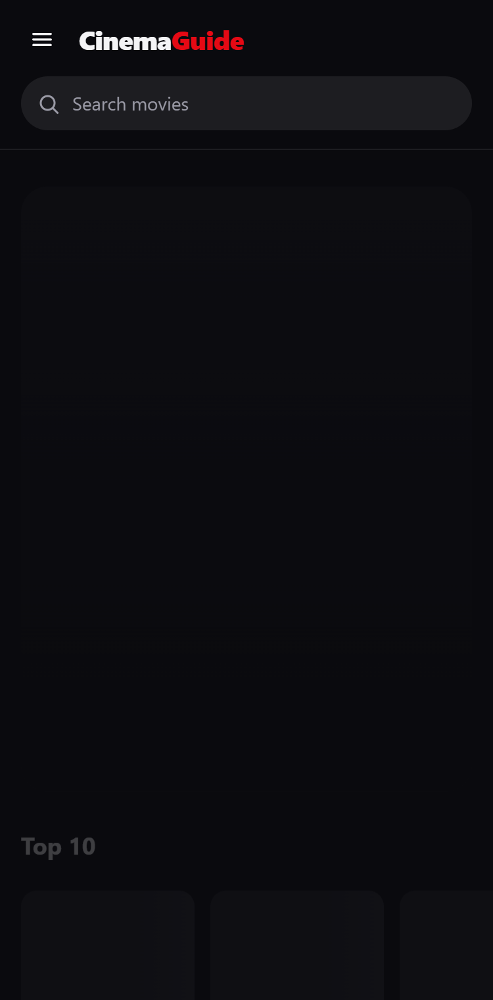

# CinemaGuide — movie catalog

A movie catalog built with React and TypeScript. Browse movies by genre, search the catalog, watch trailers and keep a list of favorites in your account.

**[Live demo](https://bob-kikosh.github.io/cinema-guide/)**



| Movie page | Genres | Mobile |
| --- | --- | --- |
|  |  |  |

## Features

- **Home page** with a featured random movie (shuffle it for another one), the Top 10 row and genre rows.
- **Movie page** with the rating, runtime, genres, plot, production facts, a trailer in a modal window and similar movies.
- **Genres** as cards with stills from the movies, and a genre page with infinite scrolling.
- **Search** with instant suggestions in the header and a full results page.
- **Accounts.** Sign up, sign in and sign out; the session is restored on reload.
- **Favorites.** Add or remove a movie from any card; the list lives on the account page.
- **Responsive layout** from 320px phones to wide desktops.
- **Loading and error states:** skeleton cards, empty results, a 404 page, messages for failed requests.
- **Accessibility:** semantic markup, keyboard-friendly modals (Escape, backdrop click), visible focus, labels on icon buttons, reduced-motion support.

## Tech stack

- React 19, TypeScript, Vite
- React Router 7 (`HashRouter`, so deep links work on static hosting)
- Axios, react-hot-toast
- Plain CSS with custom properties, one stylesheet per component
- ESLint

## Getting started

```bash
npm install
```

```bash
npm run dev
```

The app opens at `http://localhost:5173`.

Production build:

```bash
npm run build
```

Lint:

```bash
npm run lint
```

## Project structure

```text
src/
├── api/          # API client and requests: movies, auth, favorites
├── components/   # Reusable UI: Header, HeroBanner, MovieCard, MovieRow, Modal, SearchBox…
├── context/      # Auth context: current user, favorites, sign-in modal
├── hooks/        # useMovieList (paginated list), useDebounce
├── pages/        # One folder per route
├── types/        # Shared TypeScript types
├── utils/        # Formatting helpers
├── App.tsx       # Routes and page layout
└── main.tsx      # Entry point
```

## How it works

- **Auth state** lives in one context (`context/AuthProvider.tsx`). It holds the current user, their favorite ids and the state of the sign-in modal, so any component can toggle a favorite or ask the visitor to sign in.
- **Favorites are updated optimistically:** the heart switches immediately and rolls back if the request fails.
- **Lists** use the `useMovieList` hook: it loads pages, removes duplicates and stops when the API has nothing left. An `IntersectionObserver` triggers the next page.
- **Requests are cancelled** with `AbortController` when a component unmounts or its parameters change, so outdated responses never overwrite fresh ones.

## API

Movie data comes from the public CinemaGuide API (`cinemaguide.skillbox.cc`), a training API provided by Skillbox. The project has no backend of its own, so the demo depends on that service being online.

The API keeps the session in a cookie. In development requests go through the Vite proxy; in production they go to the API directly, so signing in on the live demo requires a browser that allows third-party cookies.

## About

A study project. It started as a course assignment built on the CinemaGuide API; the application code in this repository is my own work.
